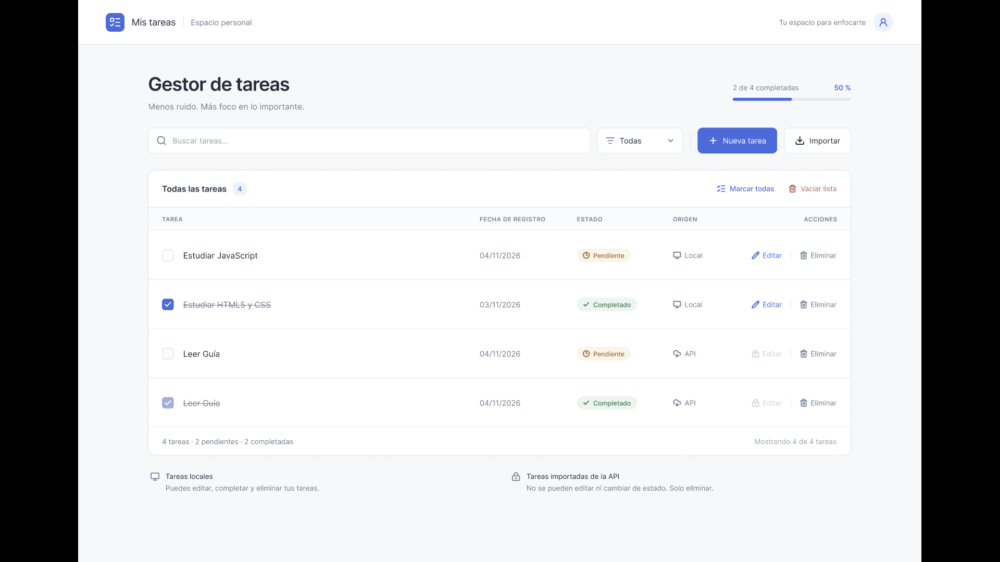
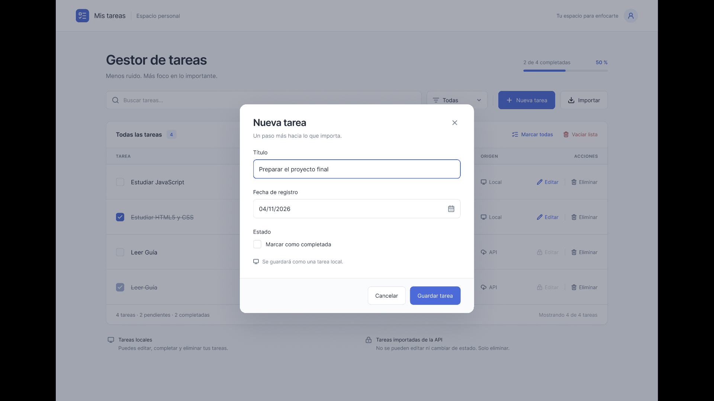
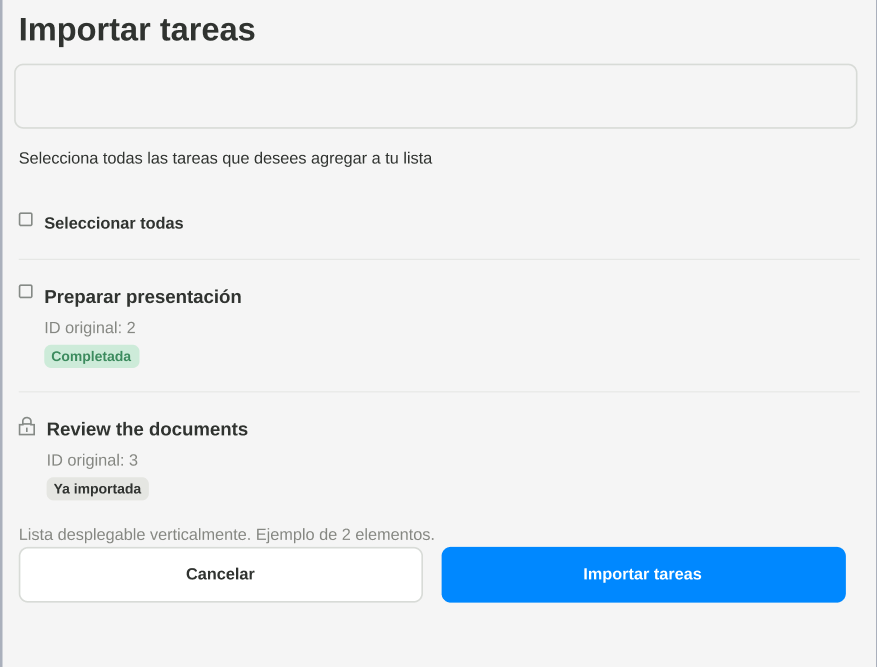
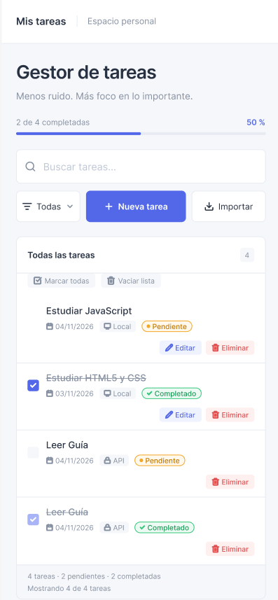
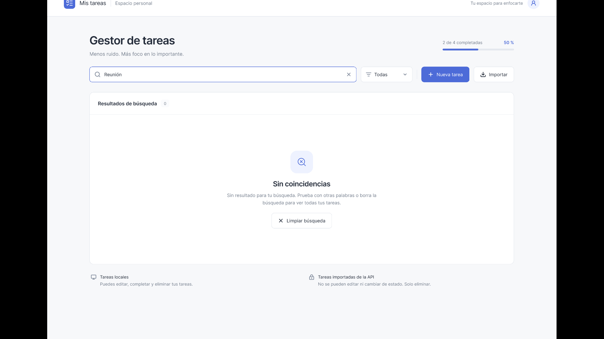
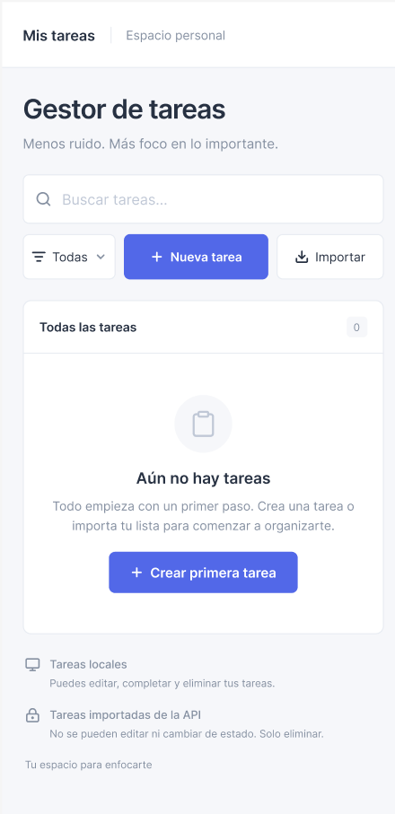
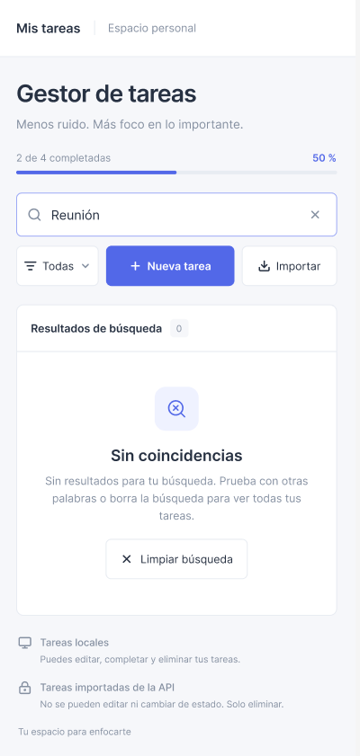

# Gestor de tareas

Aplicación web para crear, organizar e importar tareas, construida con **JavaScript puro**, **Web Components** y **Shadow DOM**, sin librerías ni frameworks. Permite gestionar tareas locales, importar tareas desde una API pública (JSONPlaceholder), buscarlas, filtrarlas y conservarlas en el navegador entre sesiones.

> Proyecto desarrollado en equipo por dos integrantes con ramas independientes e integración mediante Pull Requests.

## Tabla de contenido

1. [Tecnologías](#tecnologías)
2. [Funcionalidades](#funcionalidades)
3. [Wireframes](#wireframes)
4. [Instrucciones de uso](#instrucciones-de-uso)
5. [Instalación, ejecución y despliegue](#instalación-ejecución-y-despliegue)
6. [Estructura del proyecto](#estructura-del-proyecto)
7. [Lógica implementada](#lógica-implementada)
8. [Integración con la API](#integración-con-la-api)
9. [Accesibilidad](#accesibilidad)
10. [Diseño responsive](#diseño-responsive)
11. [Pruebas realizadas](#pruebas-realizadas)
12. [Decisiones de diseño y limitaciones](#decisiones-de-diseño-y-limitaciones)
13. [Trabajo en equipo](#trabajo-en-equipo)

## Tecnologías

| Tecnología | Uso en el proyecto |
|---|---|
| HTML5 | Estructura de la página y elementos semánticos (`<main>`, `<header>`, `<dialog>`, `<label>`). |
| CSS3 | Variables CSS compartidas, Grid y Flexbox, diseño responsive. |
| JavaScript (módulos ES) | Lógica de la aplicación dividida en servicios y componentes. |
| Web Components | Elementos personalizados (`<task-app>`, `<task-list>`, `<task-item>`, etc.). |
| Shadow DOM | Estilos y estructura encapsulados dentro de cada componente. |
| Fetch API | Consulta de las tareas de JSONPlaceholder. |
| localStorage | Persistencia de las tareas en el navegador. |

## Funcionalidades

- **Tareas locales**: crear, editar, marcar como completada o pendiente y eliminar.
- **Formulario modal** con título, estado y fecha de registro (automática, no editable).
- **Importación desde la API**: banco de 200 tareas de JSONPlaceholder, con búsqueda, selección múltiple, «Seleccionar todas las disponibles» y marca «Ya importada» para evitar duplicados.
- **Búsqueda** por título (ignora mayúsculas y tildes) y **filtro** por estado: todas, pendientes y completadas.
- **Marcar todas** como completadas (solo las locales) y **vaciar lista**, ambas con mensaje informativo.
- **Barra de progreso** con el número de tareas completadas y el porcentaje.
- **Persistencia**: las tareas se conservan al recargar la página.
- **Manejo de errores**: si la API falla, se muestra el error con un botón «Reintentar» y las funciones locales siguen disponibles.
- **Estados vacíos**: mensajes claros cuando no hay tareas o no hay resultados.
- **Accesible y responsive**: se usa con teclado y lector de pantalla, y se adapta a escritorio, tablet y móvil.

## Wireframes

Los wireframes se dibujaron antes de programar los componentes y están en la carpeta [`wireframes/`](wireframes/).

### Escritorio



### Modal de crear y editar tarea



### Modal de importación



### Móvil



### Otros estados

| Sin coincidencias (escritorio) | Móvil sin tareas | Móvil sin coincidencias |
|---|---|---|
|  |  |  |

La carpeta `wireframes/evidencia_dibujo/` conserva las fotografías de los bocetos hechos a mano.

## Instrucciones de uso

1. **Crear una tarea**: pulsa **+ Nueva tarea**, escribe el título (obligatorio), marca «Marcar como completada» si lo necesitas y pulsa **Guardar tarea**.
2. **Editar una tarea local**: pulsa **Editar** en su fila, cambia el título o el estado y guarda. La fecha de registro no cambia.
3. **Completar o reabrir una tarea local**: marca o desmarca la casilla de su fila.
4. **Eliminar una tarea**: pulsa **Eliminar** y confirma el aviso.
5. **Importar tareas**: pulsa **↓ Importar**, busca o selecciona las tareas que quieras (o «Seleccionar todas las disponibles») y pulsa **Importar seleccionadas**. Las que ya importaste aparecen como «Ya importada» y no se pueden volver a elegir.
6. **Buscar y filtrar**: escribe en el buscador o elige un estado en el desplegable. Para volver a ver todo, usa **Limpiar búsqueda**.
7. **Marcar todas**: completa todas las tareas locales pendientes. Las importadas no cambian.
8. **Vaciar lista**: elimina todas las tareas, locales e importadas, después de pedir confirmación.

**Reglas de las tareas importadas:** conservan el estado que traen de la API. No se pueden editar ni cambiar de estado; solo se pueden eliminar. En la lista aparecen con el botón Editar y la casilla deshabilitados.

## Instalación, ejecución y despliegue

La aplicación es **estática**: no necesita instalar dependencias ni compilar. Como usa módulos ES (`import`), debe abrirse desde un servidor web; si se abre el archivo con doble clic (`file://`), el navegador bloquea los módulos.

### Requisitos

- Un navegador moderno actualizado (Chrome, Edge, Firefox o Safari).
- Conexión a internet para importar tareas desde la API (el resto funciona sin conexión).

### Ejecutar en local

**Opción 1: Live Server (Visual Studio Code)**

1. Clona el repositorio: `git clone <URL-del-repositorio>`
2. Abre la carpeta del proyecto en Visual Studio Code.
3. Instala la extensión **Live Server**.
4. Haz clic derecho sobre `index.html` y elige **Open with Live Server**.

**Opción 2: servidor de Python**

```bash
cd carpeta-del-proyecto
python3 -m http.server 8000
```

Abre `http://localhost:8000` en el navegador.

**Opción 3: servidor de Node.js**

```bash
cd carpeta-del-proyecto
npx serve .
```

### Desplegar en GitHub Pages

1. Sube el proyecto a un repositorio de GitHub con `index.html` en la raíz.
2. Entra en **Settings → Pages**.
3. En **Build and deployment**, elige **Deploy from a branch**, selecciona la rama `main` y la carpeta `/ (root)`, y pulsa **Save**.
4. Espera uno o dos minutos. La aplicación quedará disponible en `https://<usuario>.github.io/<repositorio>/`.

> Los repositorios privados solo pueden publicarse en GitHub Pages con algunos planes de pago. Como alternativa gratuita se puede desplegar la carpeta en **Netlify** o **Vercel** (basta con arrastrarla o importar el repositorio; no hay comando de compilación).

Todas las rutas del proyecto son relativas, por lo que funciona igual en la raíz de un dominio o en una subcarpeta como la de GitHub Pages.

## Estructura del proyecto

```text
Proyecto_Javascript/
├── index.html
├── Readme.md
├── wireframes/
│   ├── escritorio.png
│   ├── modal-formulario.png
│   ├── modal-importacion.png
│   ├── movil.png
│   └── ... (otros estados y evidencia del dibujo)
├── css/
│   ├── global.css
│   ├── task-app.css
│   ├── task-list.css
│   ├── task-item.css
│   ├── task-form-modal.css
│   └── task-import-modal.css
└── js/
    ├── app.js
    ├── shared/
    │   ├── constants.js
    │   └── utils.js
    ├── services/
    │   ├── taskService.js
    │   ├── filterService.js
    │   ├── apiService.js
    │   └── importService.js
    └── components/
        ├── task-app.js
        ├── task-list.js
        ├── task-item.js
        ├── task-form-modal.js
        └── task-import-modal.js
```

| Archivo o carpeta | Responsabilidad |
|---|---|
| `index.html` | Página única: carga `global.css`, el elemento `<task-app>` y `js/app.js` como módulo. |
| `js/app.js` | Controlador: registra los componentes, escucha los eventos de la interfaz y conecta los servicios con la pantalla. |
| `js/shared/constants.js` | Valores compartidos: clave de localStorage, URL de la API, orígenes, estados y nombres de eventos. |
| `js/shared/utils.js` | `generateId()` y las funciones que crean tareas locales e importadas. |
| `js/services/taskService.js` | CRUD de tareas, marcar todas, vaciar, importar y persistencia. |
| `js/services/filterService.js` | Búsqueda por texto y filtro por estado. |
| `js/services/apiService.js` | Consulta a JSONPlaceholder y manejo de errores. |
| `js/services/importService.js` | Convierte las tareas de la API al formato interno. |
| `js/components/` | Los cinco Web Components de la interfaz. |
| `css/` | `global.css` define las variables y los estilos generales; cada componente tiene su propio CSS. |

## Lógica implementada

### Arquitectura

La interfaz y los datos están separados. Los componentes **no guardan ni modifican datos**: solo muestran información y emiten eventos. El controlador (`app.js`) escucha esos eventos, llama a los servicios y vuelve a pintar la pantalla con el resultado.

```text
Componentes (interfaz)  ──eventos──▶  app.js (controlador)  ──llama──▶  Servicios
        ▲                                     │                              │
        └────────── setTasks(), showMessage() ┘            localStorage / API
```

### Objeto tarea

Todas las tareas, locales o importadas, tienen la misma forma y viven en un único arreglo:

```js
{
  id: "task-<uuid>",                    // identificador interno, siempre de generateId()
  title: "Estudiar JavaScript",         // no puede estar vacío
  createdAt: "2026-11-09T18:00:00.000Z",// fecha de registro o de importación
  completed: false,
  origin: "local",                      // "local" o "api"
  sourceId: null                        // id original de JSONPlaceholder; null si es local
}
```

El `id` de JSONPlaceholder nunca se usa como identificador interno: se guarda en `sourceId`, para no mezclar identificadores externos con los de la aplicación. `generateId()` usa `crypto.randomUUID()` y, si el navegador no lo ofrece (fuera de HTTPS o `localhost`), genera un identificador alternativo.

### Servicios

**`taskService.js`** es el único módulo que toca el arreglo de tareas y localStorage.

- Funciones: `loadTasks`, `getTasks`, `addTask`, `updateTask`, `toggleTask`, `deleteTask`, `completeAll`, `clearTasks` e `importTasks`.
- Todas las funciones que modifican datos devuelven un objeto con el mismo formato y **no lanzan errores por reglas de negocio**:

  ```js
  { ok: true, data: tarea }               // addTask, updateTask, toggleTask
  { ok: true, deleted: 1 }                // deleteTask (clearTasks devuelve el total)
  { ok: true, updated: 5 }                // completeAll
  { ok: true, added: 3, skipped: 2 }      // importTasks
  { ok: false, message: "..." }           // rechazo por una regla de negocio
  ```

- `updateTask` y `toggleTask` rechazan las tareas importadas, y `addTask` y `updateTask` rechazan los títulos vacíos.
- Al editar se conservan `createdAt`, `origin` y `sourceId`.
- `completeAll` solo cambia las tareas locales y devuelve cuántas cambió.
- `importTasks` agrega las tareas, omite las que ya existen (mismo `sourceId` con origen `api`, incluso dentro del mismo lote) y devuelve cuántas agregó y cuántas omitió. No reemplaza ni borra las tareas locales.
- Si el navegador no puede guardar, el cambio se revierte y se devuelve `ok: false`.

**`filterService.js`**: `filterTasks(tasks, status, query)` es una función pura que devuelve un arreglo nuevo. La búsqueda ignora mayúsculas y tildes.

**`apiService.js`**: `getApiTasks()` consulta la API y devuelve `{ ok: true, data }` o `{ ok: false, message }` (ver [Integración con la API](#integración-con-la-api)).

**`importService.js`**: `mapSelectedApiTasks(selectedTasks)` convierte las tareas seleccionadas de la API al formato interno: genera el `id`, guarda el id original en `sourceId`, asigna `origin: "api"` y registra la fecha de importación.

### Persistencia con localStorage

- Todas las tareas se guardan en **una sola clave**: `proyecto-tareas-v1`.
- Al arrancar, `loadTasks()` lee y valida los datos. Si el JSON está dañado o no tiene el formato esperado, la aplicación arranca con la lista vacía y muestra un mensaje, sin romperse.
- Cada operación que cambia las tareas las vuelve a guardar. Los componentes nunca acceden a localStorage.

### Web Components y Shadow DOM

Cada componente extiende `HTMLElement` y crea su propio Shadow DOM con `attachShadow({ mode: "open" })`. Cada uno carga su propia hoja de estilos dentro de su Shadow DOM, de modo que los estilos de un componente no afectan a los demás.

Lo único que atraviesa el Shadow DOM son las **variables CSS** definidas en `:root` (`--color-primario`, `--color-texto`, `--radio`, `--espacio`, etc.). Por eso los colores y espaciados se declaran en `global.css` y todos los componentes los usan, con un valor de respaldo.

```text
<task-app>
  ├── <task-list>
  │     └── <task-item> (una por tarea)
  ├── <task-form-modal>
  └── <task-import-modal>
```

| Componente | Responsabilidad | Interfaz pública |
|---|---|---|
| `<task-app>` | Pantalla principal: título, progreso, buscador, filtro, botones y mensajes. | `setTasks(tasks, filtered)`, `setSummary(tasks)`, `setApiTasks()`, `setImportedIds()`, `setApiStatus()`, `setSearchAndFilter()`, `showMessage()`, `openForm()` |
| `<task-list>` | Cabecera de columnas, filas y estados vacíos. | propiedades `tasks` y `filtered` |
| `<task-item>` | Una tarea y sus acciones según su origen. | propiedad `task` |
| `<task-form-modal>` | Formulario para crear y editar. | `open(task)` |
| `<task-import-modal>` | Banco de tareas de la API con selección múltiple. | `open()`, `setApiTasks()`, `setImportedIds()`, `setApiStatus()` |

### Eventos

Los componentes se comunican con el controlador mediante `CustomEvent`, con `bubbles: true` y `composed: true` para que atraviesen el Shadow DOM. El controlador los escucha en el elemento `<task-app>`.

| Evento | Detalle | Qué hace el controlador |
|---|---|---|
| `task:save` | `{ id, title, completed }` | Si `id` es `null` crea la tarea; si no, la actualiza. |
| `task:edit` | `{ id }` | Abre el formulario con los datos de la tarea (vacío si `id` es `null`). |
| `task:toggle` | `{ id }` | Cambia el estado; el servicio valida el origen. |
| `task:delete` | `{ id }` | Elimina la tarea. |
| `task:clear` | `{}` | Pide confirmación y vacía la lista. |
| `task:complete-all` | `{}` | Completa las tareas locales e informa cuántas cambiaron. |
| `task:import` | `{ sourceIds: number[] }` | Busca esas tareas en el banco, las convierte y las guarda. |
| `task:filter` | `{ status }` | Actualiza el filtro de estado. |
| `task:search` | `{ query }` | Actualiza el texto de búsqueda (el buscador espera unos 250 ms antes de emitirlo). |
| `task:api-retry` | `{}` | Vuelve a consultar la API. |

### Flujo de una acción

Por ejemplo, al crear una tarea:

1. `<task-form-modal>` valida el título y emite `task:save`.
2. `app.js` recibe el evento y llama a `addTask()`.
3. El servicio crea la tarea, la guarda en localStorage y devuelve `{ ok: true, data }`.
4. `app.js` llama a `refreshView()`: obtiene las tareas, aplica `filterTasks()` y actualiza `<task-app>`, que a su vez actualiza la lista y el progreso.
5. `showMessage()` informa el resultado en una región `aria-live`.

## Integración con la API

Las tareas se obtienen de **JSONPlaceholder**: `https://jsonplaceholder.typicode.com/todos` (200 tareas con `id`, `title` y `completed`).

1. **Carga inicial**: al arrancar, `app.js` consulta la API en segundo plano sin bloquear la aplicación. Mientras tanto el modal de importación muestra «Consultando tareas...».
2. **Validaciones** en `apiService.js`: se comprueba `respuesta.ok` (los códigos HTTP de error se tratan como fallo), se convierte la respuesta a JSON y se verifica que sea un arreglo.
3. **Estados** que se comunican con `setApiStatus()`: `loading`, `ok` y `error`.
4. **Si falla** (sin conexión, error del servidor o respuesta inválida): el modal muestra un mensaje de error, desactiva el botón de importar y ofrece **Reintentar**, que vuelve a llamar a la API.
5. **La API caída no bloquea la aplicación**: crear, editar, completar y eliminar tareas locales siguen funcionando.
6. **Importación**: las tareas elegidas se convierten (`importService.js`), se guardan (`importTasks`) y las ya importadas se marcan como «Ya importada» en el banco.

## Accesibilidad

- **Modales**: el formulario usa `<dialog>` con `showModal()`; el modal de importación usa `role="dialog"` y `aria-modal="true"`. Ambos tienen `aria-labelledby`, mueven el foco al abrir, mantienen el foco dentro mientras están abiertos, se cierran con **Esc** y devuelven el foco al botón que los abrió.
- **Formularios**: cada campo tiene su `<label>`; el buscador y el filtro tienen `aria-label`. El error de validación aparece junto al campo y se asocia con `aria-describedby` y `aria-invalid`, no solo con una alerta.
- **Botones de icono** con `aria-label` descriptivo, por ejemplo «Eliminar tarea: Estudiar JavaScript».
- **Mensajes** de éxito y error en una región `aria-live="polite"`.
- **Estados vacíos** claros: «Aún no hay tareas» y «Sin resultados para tu búsqueda».
- **Acciones destructivas** con confirmación: eliminar una tarea y vaciar la lista.
- **Contraste**: los textos cumplen un contraste mínimo de 4.5:1 sobre su fondo.
- **Foco visible** en todos los elementos interactivos.
- **Textos de usuario seguros**: los títulos se insertan con `textContent`, no como HTML, para evitar que un título de la API inyecte código.

## Diseño responsive

El diseño se adapta con una media query en 900 px (desktop-first):

- **Escritorio**: la lista se muestra como tabla con las columnas Tarea, Fecha de registro, Estado, Origen y Acciones.
- **Tablet y móvil (hasta 900 px)**: cada tarea pasa a ser una tarjeta con título, fecha, estado, origen y acciones. La barra de controles se apila, los botones de acción son de al menos 44 px y no hay desbordamiento horizontal.
- **Pantallas muy pequeñas (hasta 380 px)**: ajustes adicionales de espaciado.
- Los modales se adaptan al ancho de la pantalla; en el modal de importación el listado tiene desplazamiento interno porque el banco tiene 200 tareas.

## Pruebas realizadas

| Prueba | Resultado esperado | Resultado |
|---|---|---|
| Crear tarea local | Se muestra en la lista y se guarda; un título vacío se rechaza con mensaje. | ✅ |
| Formulario con «completada» | Se crea o edita marcando «Completada»; la fecha de registro se muestra y no cambia al editar. | ✅ |
| Editar tarea local | Se modifica el título y se conserva la fecha original. | ✅ |
| Completar tarea local | `completed` cambia entre `true` y `false`. | ✅ |
| Marcar todas como terminadas | Las locales quedan completadas, las importadas no cambian y se informa cuántas. | ✅ |
| Recargar el navegador | Las tareas permanecen guardadas. | ✅ |
| Importar varias tareas | Se agregan al mismo listado. | ✅ |
| Importar duplicada | No se agrega de nuevo; el modal la muestra como «Ya importada». | ✅ |
| Editar o completar una importada | La acción no está disponible y el servicio la rechaza. | ✅ |
| Eliminar una importada | Se elimina correctamente. | ✅ |
| Buscar y filtrar | La lista refleja texto y estado; sin coincidencias dice «Sin resultados». | ✅ |
| Vaciar lista | Pide confirmación y elimina todas. | ✅ |
| API sin conexión | Se muestra el error, el modal ofrece «Reintentar» y la app local sigue funcionando. | ✅ |
| Teclado y modales | Esc cierra los modales, el foco no se escapa y vuelve al botón que los abrió. | ✅ |
| Etiquetas y contraste | Inputs con label, botones de icono con `aria-label`, foco visible y contraste suficiente. | ✅ |
| Vista móvil | No hay desbordamiento ni controles inaccesibles. | ✅ |

Además se comprobó que no aparecen errores en la consola del navegador durante el uso normal.

## Decisiones de diseño y limitaciones

- **Tareas importadas de solo lectura**: no se pueden editar ni cambiar de estado, solo eliminar. La regla se aplica en la interfaz (botón Editar y casilla deshabilitados) y también en el servicio, que las rechaza con un mensaje. Se bloquea también el cambio de estado porque la regla del proyecto indica que las tareas importadas no se pueden actualizar; si se necesitara lo contrario, bastaría con ajustar `toggleTask` y la casilla de `task-item`.
- **Una sola fuente de verdad**: todas las tareas viven en un único arreglo y una sola clave de localStorage.
- **Componentes sin lógica de datos**: facilita probarlos por separado y evita que dos partes modifiquen los mismos datos.
- **Confirmación nativa** (`window.confirm`) para eliminar y vaciar: es accesible por defecto, aunque no se puede personalizar visualmente.
- **Importación sin sincronización**: las tareas importadas son una copia; si cambian en la API, no se actualizan en la aplicación.
- **Almacenamiento local**: los datos viven en el navegador del usuario; no se comparten entre dispositivos ni navegadores y se pierden si se borran los datos del sitio.
- **Dependencia de la API**: sin conexión no se pueden importar tareas nuevas, pero las tareas ya guardadas y las locales siguen disponibles.

## Trabajo en equipo

El desarrollo se dividió en dos módulos a partir de un contrato común (objeto tarea, nombres de eventos, métodos públicos y variables CSS) acordado antes de separarse.

| Integrante | Módulo | Archivos principales |
|---|---|---|
| *[sara]* | Tareas y listado | `taskService.js`, `filterService.js`, `task-list.js`, `task-item.js`, `task-form-modal.js` y sus estilos |
| *[michael]* | API e integración | `apiService.js`, `importService.js`, `task-app.js`, `task-import-modal.js`, `app.js`, `index.html`, `global.css` y sus estilos |

Cada integrante trabajó en una rama propia y el trabajo se integró en `main` mediante Pull Requests y merges, revisando que la aplicación siguiera funcionando.

## Autores

- *[Michael Daniel Martinez Buenahora]*
- *[Sara Yuliana Borda Ochoa]*
